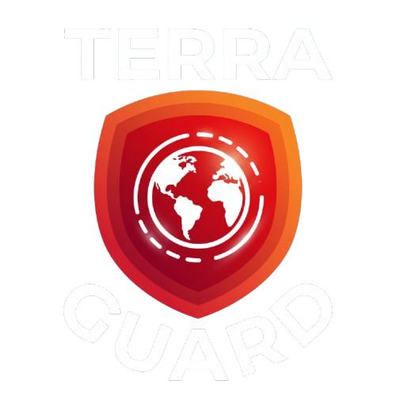

<p align="center">
  
</p>

# Terra Guard V2 🇲🇾 — Citizen Disaster Companion

> **Mobile-first, cognitive-de-escalation disaster monitoring and safety companion for everyday citizens (Sime Darby Hackathon Edition).**

**Terra Guard V2** is a complete civilian reimagining of the original *Terra Guard* concept. Unlike tactical command-center dashboards built for operators, **Terra Guard V2** is engineered for an ordinary person in acute distress asking:
1. *Am I safe right now?*
2. *What do I need to do this exact second?*
3. *Where is the nearest safe shelter?*

---

## ✨ Key Features

- **⚡ Split-Second Risk Status**: Color/icon-based alert tiers (*All Clear*, *Flash Flood Advisory*, *Critical Evacuation Directive*) with plain-language instructions — zero confusing gauges or radar telemetry.
- **🔐 Google Sign-In & Emergency Guest Access**: One-tap sign-in with Google (`GoogleAuthProvider`), redirect fallback for iOS standalone PWAs, password reset, and instant emergency guest access.
- **⏳ Minimal Non-Blocking Splash**: Centered breathing logo and 120px × 3px sharp square indicator with full paint isolation and zero splash/login overlay.
- **🗺️ Expansive Live Map**: Clean vector map displaying your live GPS location, real-time hazard polygons (with water depth readings), and open relief centers (PPS) with capacity meters and walking navigation routes.
- **🤖 Zero-Typing AI Safety Assistant**: 1-tap pre-composed triage chips based on verified National Civil Defence (APM / NADMA / Bomba) protocols, with integrated **Web Speech API ("Read Aloud")** for hands-free audio guidance while moving.
- **🎒 72-Hour Offline Survival Kit & Hotlines**: 100% offline checklist with local storage persistence and 1-tap direct dials to MERS 999, Bomba Dan Penyelamat, APM, and JKM Disaster Relief.
- **🌐 Bilingual (EN / BM)**: Full instant toggle between English and Bahasa Melayu for all directives, checklists, and AI prompts.
- **📱 Responsive & Ergonomic**: Desktop dashboard view (960px) + mobile-first thumb-reachable navigation.

---

## 🛠️ Tech Stack

- **Framework**: React 19 + TypeScript + Vite
- **Styling**: Vanilla CSS Design System (clean design tokens, sharp square shape language, zero Tailwind dependencies)
- **Authentication**: Firebase Authentication (Email/Password, Google OAuth Popup & Redirect, Anonymous Guest)
- **Database**: Cloud Firestore (civilian profile sync and hazard caches)
- **Token Compliance**: Automated script (`npm run check:colors`) ensuring 100% tokenized color architecture
- **Icons**: Lucide React + Official Google SVG mark
- **Audio / Speech**: Web Audio API (tactile alert chimes) + Web Speech API (text-to-speech)

---

## 🚀 Getting Started

### Prerequisites
- Node.js (v18+ recommended)
- npm or yarn

### Installation & Local Run
```bash
# Clone the repository
git clone https://github.com/airilakio29/terra-guard-v2.git
cd terra-guard-v2

# Install dependencies
npm install

# Start development server
npm run dev
```

Open [http://localhost:5173/](http://localhost:5173/) in your browser.

### Build Production Bundle
```bash
npm run build
```

---

## 🧪 Evaluator Demo Scenarios

Use the top selector bar to simulate real-world conditions:
- **Subang (Advisory)**: 0.6m rising water along Persiaran Kewajipan underpass with shelter routing to Dewan MPSJ USJ 7.
- **Kelantan (Danger)**: Critical river overflow (1.4m depth) with immediate evacuation directives to SMK Sultan Ibrahim.
- **Penang (Safe)**: All-clear baseline with 72-hour survival kit preparedness.

---

## 📲 Progressive Web App (PWA) & Offline Architecture

Terra Guard V2 is an installable, cross-platform Progressive Web App engineered to run identically on Android, iOS, and desktop browsers with full offline emergency survival capabilities.

### 📥 How to Install the App

#### Android & Desktop (Chrome / Edge / Samsung Internet)
1. Navigate to [terra-guard-v2.vercel.app](https://terra-guard-v2.vercel.app).
2. After 12 seconds of active dashboard usage, a dismissible **"Install Terra Guard V2"** banner will slide up at the bottom.
3. Tap **"Install App"** to trigger the native installation prompt, or open **Settings ⚙️ &rarr; Progressive Web App &rarr; Install App**.
4. The app will be installed to your home screen or app drawer with dedicated app shortcuts:
   - Long-press the app icon on Android to immediately jump to **"SOS & Survival Kit"** or **"Live Relief Map"**.

#### iOS & iPadOS (Apple Safari)
*Apple Safari does not support the automated Web App Install Banner API, so an illustrated 3-step guide is built-in:*
1. Open [terra-guard-v2.vercel.app](https://terra-guard-v2.vercel.app) in **Safari**.
2. Tap the **Share** button (box with an upward arrow) in the center of Safari's bottom toolbar.
3. Scroll down and tap **"Add to Home Screen"** (Tambah ke Skrin Utama) with the plus icon.
4. Tap **"Add"** in the top right corner.
5. Launch Terra Guard V2 from your home screen to run in edge-to-edge standalone mode with custom startup splash screens and notch safe-area handling.

---

### 🎨 How to Regenerate PWA Icons & iOS Splash Screens
All PWA icons and Apple startup screens are automatically generated from `public/logo.png` using Node.js and `sharp`:
```bash
node scripts/generate-pwa-assets.cjs
```
This single script regenerates:
- `public/pwa-192x192.png` (Standard 192px Android home screen icon)
- `public/pwa-512x512.png` (Standard 512px icon for splash screens and app stores)
- `public/pwa-maskable-512x512.png` (512px icon with 80% safe inner zone padding on `#F8FAFC` background)
- `public/apple-touch-icon.png` (180x180 solid `#F8FAFC` background, strictly non-transparent for iOS)
- `public/favicon-32x32.png` & `public/favicon-16x16.png`
- `public/splash/apple-splash-*.png` (6 pixel-perfect startup splash screens matching iPhone 16/15 Pro Max, standard iPhones, iPhone SE, and iPad Pro/Air)

---

### 🔄 How Updates Work
- Workbox is configured with `registerType: 'prompt'`.
- When an updated service worker is installed in the background, a floating banner announces **"New version available • Refresh"**.
- **Emergency Protection**: To protect civilian lives, update prompts are automatically suppressed during active SOS emergency holding or triggered sirens (`isSosActive`).
- Clicking **"Refresh"** (`updateApp()`) triggers `skipWaiting()` and updates the app cleanly without breaking offline state.

---

### ⚠️ Known iOS Standalone Limitations & Mitigations
1. **Google Sign-In Popup Behavior**:
   - In iOS standalone mode (Add to Home Screen), Safari blocks secondary OAuth popup windows or opens them in a detached sheet that loses session credentials.
   - **Mitigation**: Terra Guard V2 automatically detects iOS standalone mode and seamlessly routes Google Auth through `signInWithRedirect()` with `getRedirectResult()` on app boot. Email/Password sign-in and Guest Mode are also always available offline.
2. **Launch White Flash**:
   - iOS standalone web apps display an unstyled white screen unless explicit `apple-touch-startup-image` link tags are declared for each device resolution.
   - **Mitigation**: 6 startup splash images matching Apple device aspect ratios on `#F8FAFC` background are linked in `index.html`.
3. **No Automatic Install Prompt**:
   - Handled via the interactive 3-step guide modal accessible directly from the Settings screen.
4. **Push Notification Support**:
   - Web Push on iOS requires standalone mode and iOS 16.4+. Critical hotlines (999, 994, 991) and the 72-hour survival kit run locally without requiring server push.

---

### 📋 Summary of Files Changed

| Component / Area | File | Purpose |
| :--- | :--- | :--- |
| **PWA Plugin** | `vite.config.ts` | Configured `VitePWA` with Workbox runtime caching (APIMS, OpenWeather, Map Tiles, Network-only Firebase/AI). |
| **TypeScript** | `tsconfig.app.json` | Added `vite-plugin-pwa/react` compiler types. |
| **Asset Generator** | `scripts/generate-pwa-assets.cjs` | Sharp script generating 192/512/maskable icons, apple-touch-icon, and 6 iOS splash images. |
| **Manifest** | `public/manifest.json` | Web App Manifest with portrait standalone, shortcuts (`/?tab=sos`, `/?tab=map`), and theme colors. |
| **Offline Page** | `public/offline.html` | Emergency offline fallback page with 1-tap hotline dials and reconnect handler. |
| **HTML Head** | `index.html` | Added iOS touch icons, 6 startup splash links, viewport cover, and Apple meta tags. |
| **Deployment** | `vercel.json` | Cache headers: `no-cache` for `sw.js` and manifest, immutable cache for assets, SPA rewrite rule. |
| **PWA State** | `src/context/PwaContext.tsx` | Online/offline detection, standalone detection, install prompt capture, and update coordination. |
| **Banners & Modals** | `src/components/OfflineBanner.tsx` | Unobtrusive offline banner and "Back Online" recovery toast. |
| **Banners & Modals** | `src/components/PwaInstallBanner.tsx` | Delayed (12s) install prompt for Android/Desktop. |
| **Banners & Modals** | `src/components/PwaUpdateBanner.tsx` | Non-intrusive service worker refresh bar (suppressed during active SOS). |
| **Banners & Modals** | `src/components/IosInstallModal.tsx` | 3-step illustrated "Add to Home Screen" guide in EN/BM. |
| **App Assembly** | `src/App.tsx` | Wrapped with `PwaProvider`, mounted PWA banners and modal. |
| **Settings** | `src/components/SettingsScreen.tsx` | Added PWA status badge and manual Install button. |
| **Telemetry** | `src/components/LiveWeatherCard.tsx` | Added cache age & offline badge to official APIMS tile. |
| **Emergency SOS** | `src/components/SosScreen.tsx` | Connected active SOS state to `isSosActive` to guard against update interruptions. |
| **Deep Links** | `src/context/AppContext.tsx` | Enabled `/?tab=sos` and `/?tab=map` shortcut routing on startup. |
| **Styles** | `src/index.css` | Token-based styles for all PWA banners, iOS guide, notch safe-area insets, and overscroll controls. |

---

### 🔑 Manual Steps for Deployment & Firebase

1. **Firebase Console &mdash; Authorized Domains**:
   - Go to [Firebase Console](https://console.firebase.google.com) &rarr; **Authentication** &rarr; **Settings** &rarr; **Authorized domains**.
   - Ensure `terra-guard-v2.vercel.app` (and any custom domains) are added to the list so Google Sign-In and OAuth redirects succeed.
2. **Environment Variables on Vercel**:
   - Confirm that your Firebase environment variables are set in the Vercel dashboard:
     - `VITE_FIREBASE_API_KEY`
     - `VITE_FIREBASE_AUTH_DOMAIN`
     - `VITE_FIREBASE_PROJECT_ID`
     - `VITE_FIREBASE_STORAGE_BUCKET`
     - `VITE_FIREBASE_MESSAGING_SENDER_ID`
     - `VITE_FIREBASE_APP_ID`
3. **Redeploy on Vercel**:
   - Push to GitHub `main` branch to trigger the production deployment. Vercel will automatically apply `vercel.json` headers for service worker caching and deep-link rewrites.

---

## 📄 License
MIT
